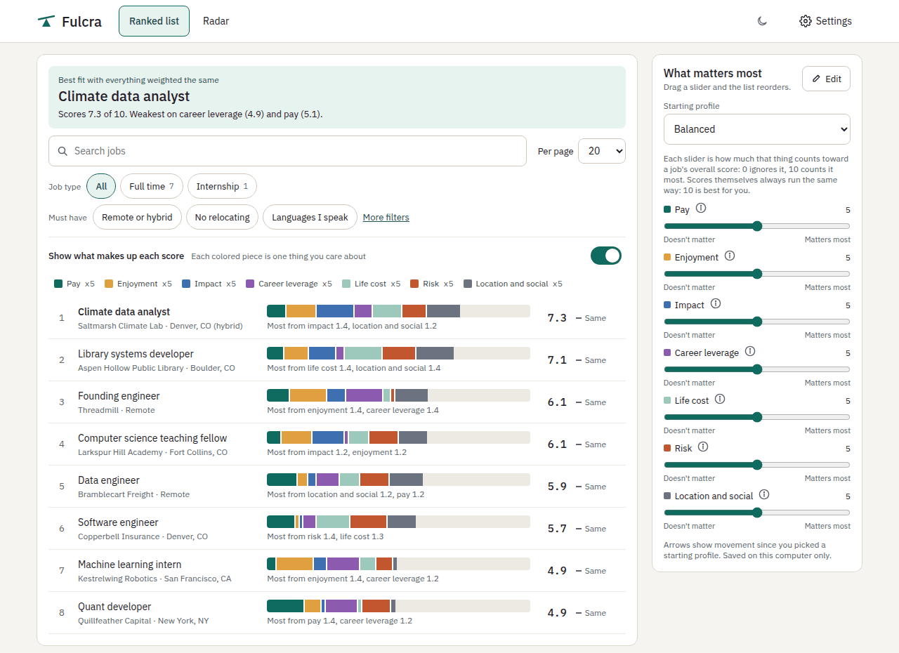
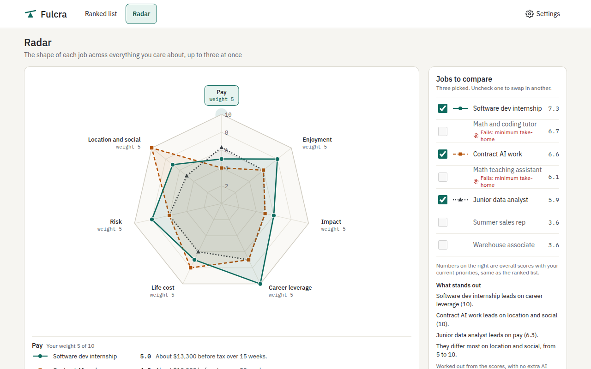
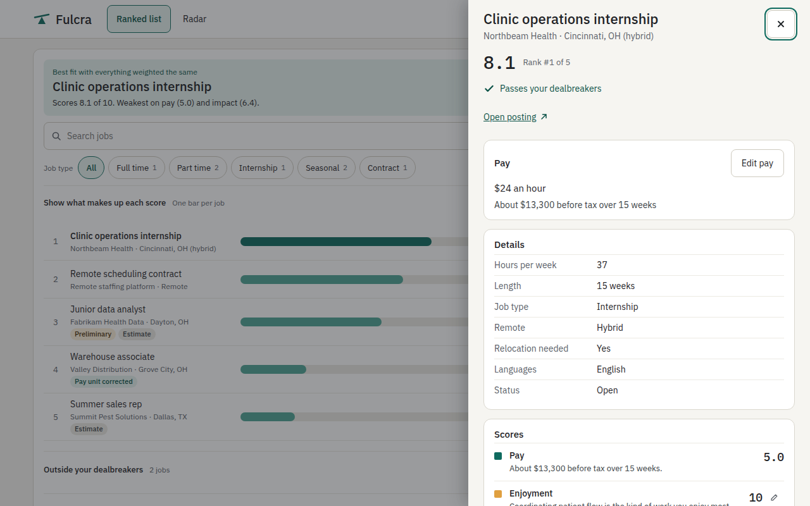
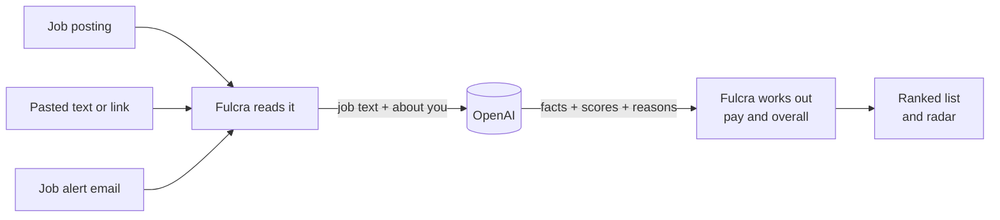

<div align="center">


# Fulcra

**Score job offers on what matters to you, not just pay.**

A free Chrome extension that reads the postings you open and the job alerts in your inbox,<br>
then ranks every job by your own priorities.

[Install](#install) · [How it works](#how-it-works) · [Cost](#cost) · [Privacy](#privacy) · [Troubleshooting](#troubleshooting) · [Contributing](#contributing)

  



</div>

## Why Fulcra

Two offers paying the same can be very different jobs. Fulcra scores each one on **seven things**, and you decide how much each one counts:

| | | |
|---|---|---|
| 💵 **Pay** | 🙂 **Enjoyment** | 🌍 **Impact** |
| 📈 **Career leverage** | ⏳ **Life cost** | ⚠️ **Risk** |
| 📍 **Location and social** | | |

Move a slider and the list reorders instantly. Rename, remove, or add up to 12 of your own.

<table>
<tr>
<td width="50%"></td>
<td width="50%"></td>
</tr>
<tr>
<td><b>Radar.</b> See the shape of any number of jobs side by side.</td>
<td><b>Every score has a reason.</b> Disagree? Type your own. Dark mode too.</td>
</tr>
</table>

- **No accounts, no servers, no analytics.** Everything lives in your browser.
- **Your own OpenAI key.** Most people spend under $1 a month. [See cost](#cost).
- **Works where the jobs are:** LinkedIn, Handshake, Indeed, any other job page, pasted text, and alert emails in Gmail and Outlook.

## Install

> [!NOTE]
> Fulcra isn't on the Chrome Web Store yet. Until it is, install it from a release. It takes a minute and needs no tools.

<details open>
<summary><b>From a release</b> (recommended)</summary>
<br>

1. Download `fulcra-<version>-chrome.zip` from the [latest release](https://github.com/jinst255/fulcra/releases/latest) and unzip it to a folder you'll keep. Chrome loads Fulcra from there each time it starts.
2. Open `chrome://extensions` and turn on **Developer mode** (top right).
3. Select **Load unpacked** and choose the unzipped folder.
4. Setup opens in a new tab.

**To update:** unzip the new release over the same folder, then select ↻ on Fulcra's card in `chrome://extensions`. Your jobs and settings stay.

</details>

<details>
<summary><b>From source</b></summary>
<br>

You need [Node.js](https://nodejs.org) 22 or newer and Git.

```sh
git clone https://github.com/jinst255/fulcra.git
cd fulcra
npm ci
npm run build
```

Then load the build folder with **Load unpacked** as above:

| System | Folder |
|---|---|
| macOS, Linux | `fulcra/.output/chrome-mv3` |
| Windows | `fulcra\.output\chrome-mv3` |

**To update:** `git pull`, `npm run build`, then select ↻ on Fulcra's card.

</details>

## Getting started

Setup opens in a tab after you install, and has four steps.

**1. Add your OpenAI key.** Fulcra scores jobs with OpenAI, billed to you directly.

1. Sign in at [platform.openai.com](https://platform.openai.com) and add a payment method under **Billing**. A ChatGPT subscription doesn't cover this.
2. Open **API keys** → **Create new secret key**, then paste it into Fulcra.
3. Fulcra tests the key before going on, and tells you if it doesn't work.

> [!TIP]
> Set a monthly spend limit under **Limits** in your OpenAI account, so costs can never surprise you.

**2. Tell it about you:** the work you're aiming for, what you enjoy, where you live, and whether you'd move or work remotely.

**3. Connect your job alert inboxes:** Gmail, Outlook, or several of each. [How email reading works](#job-alert-emails).

**4. Check the summary.** **Change** opens any step and brings you back.

## How it works



### Scoring a job

| To score… | Do this |
|---|---|
| The posting you're looking at | Select the Fulcra icon → **Score this job**, or press <kbd>Alt</kbd>+<kbd>Shift</kbd>+<kbd>F</kbd> |
| A link on any page | Right-click it → **Score this job with Fulcra** |
| An offer with no posting | Paste the text (a message from a friend, say) or a link into the popup |
| Jobs in your alert emails | Nothing. Fulcra checks your inbox on a schedule |

### Comparing jobs

- **Ranked list** is home. Drag the sliders in **What matters most** to reorder it, or start from a profile.
- **Filters** narrow both views: job type, remote or hybrid, no relocating, languages, lowest pay, most hours. Jobs that miss a must-have move to **Filtered out**; they aren't deleted.
- **Radar** compares any number of jobs. Click a dimension to sort by it; click a name to open the job.
- **Your own score:** open a job and select the pencil next to any score. If you keep correcting the same thing, Fulcra offers to change that weight.
- Closed postings move to **Closed or expired**, and anything that isn't a job folds into **Not job listings**.

### Job alert emails

Once a day, or as often as you like, Fulcra opens each inbox in a background tab inside a collapsed **Fulcra** tab group. It reads alerts that arrived since the last check, then closes the tab.

- **Who it reads:** only the addresses under **Settings → Job alert emails → Alert senders**. LinkedIn and Handshake are there to start. Add any other sender, like Indeed, a company's careers site, or a friend who forwards you jobs.
- **What it leaves alone:** everything else. Alerts stay marked unread.
- **Older alerts:** **Import past alerts** reads the last 7, 30, or 90 days, or everything. It shows the expected number of jobs and the cost first.
- **Scores from email are Preliminary.** An alert has only a title, company, place, and pay. Open the posting and Fulcra upgrades it to a full score.

> [!IMPORTANT]
> Forward alerts **normally**, not as an attachment. Fulcra can't read jobs inside an attached email.

<details>
<summary><b>The math behind the scores</b></summary>

<br>

The model scores every dimension except pay from 1 to 10, where 10 is always best for you, and gives a one-line reason. Fulcra works out pay and the overall score itself.

**Pay.** Fulcra converts the posting's pay range midpoint to weekly pay. Hourly pay is multiplied by hours per week (40 if the posting doesn't say). Monthly is × 12 ÷ 52, yearly is ÷ 52, and a whole-job amount is divided by the job's length in weeks. Over your time frame of *W* weeks, take-home is

```math
T = \text{weekly pay} \times \min(\text{job weeks},\ W) - \text{known costs}
```

```math
\text{pay score} = 1 + 9 \times \min\!\left(1,\ \max\!\left(0,\ \tfrac{T}{G}\right)\right)
```

where *G* is your pay goal, or the best take-home among your open jobs if you haven't set one. With **No set time frame**, jobs are compared by pay rate instead.

- Everything is before tax. Benefits and equity are left out unless the posting states a total.
- Missing pay is estimated by the model and labeled **Estimate**.
- Impossible units, like "$110,000 an hour", are fixed and labeled **Pay unit corrected**, with an Undo.

**Spread across your jobs.** By default, each dimension's AI scores are stretched so your best job on it shows 10 and your weakest shows 1. This needs three scored jobs and at least a point of difference. Your own scores are never stretched. Turn it off under **Settings → Scoring**.

**Overall.** With your weights *w* (0 to 10) and scores *s*, over the dimensions that have a score:

```math
\text{overall} = \frac{\sum w \cdot s}{\sum w}
```

If every weight is 0, they all count equally.

**Filters** check facts from the posting, never the model's opinion. If Fulcra can't tell, the job stays in.

</details>

## Cost

You pay OpenAI directly for what you score. Fulcra itself is free.

| Model | Per 1,000 jobs | Good for |
|---|---|---|
| **Standard** (default) | about $1.20 | Almost everyone |
| **Sharper** | about $4.50 | When Standard's scores feel off |

Fulcra picks the cheapest way to score, so there's nothing to approve:

- **While you're using Fulcra**, jobs are scored right away.
- **While you're away**, say, after an overnight email check, jobs go to OpenAI's Batch API at **half price**. Results come back within 24 hours, usually within an hour.
- **When you come back early**, a banner shows the progress and a **Score now** button with its price.

**Re-score all** shows the count and cost before it starts.

## Privacy

| Sent to OpenAI, only when a job is scored | Stays in your browser |
|---|---|
| The job's text | Your jobs, scores, and settings |
| Your answers from **About you** | Your OpenAI key |
| What each of your dimensions means | Your emails, apart from the job details in alerts |

- Your key is only ever sent to `api.openai.com` and never syncs to your Google account. **It isn't encrypted on disk**, so anyone with access to your browser profile could read it. That's why the spend limit matters.
- No analytics, telemetry, or remote code. Fulcra has no servers to send anything to.
- **Settings → Your data → Reset Fulcra** deletes everything and starts setup again. Your key still exists in your OpenAI account; delete it there under **API keys**.

Full details are in [PRIVACY.md](PRIVACY.md).

## Troubleshooting

| What you see | What to do |
|---|---|
| **"That key didn't work"** | Create a new key at [platform.openai.com/api-keys](https://platform.openai.com/api-keys) and paste the whole thing. Check **Billing** has a payment method. |
| **"Job saved, not scored yet"** | Fulcra keeps the job and scores it once the problem it names (key, credit, or connection) is fixed. |
| **An email check finds no new jobs** | Make sure the sender is under **Alert senders**, and that alerts are forwarded normally, not as attachments. The result says whether it found no listings or only jobs you already have. |
| **An email check says the layout changed** | Gmail or Outlook may have changed their page. [Report it](#reporting-a-problem) with diagnostics. |
| **A posting won't score** | Select the text of the posting, copy it, and paste it into the popup. Pasting always works. |

### Reporting a problem

Open **Settings → Help and diagnostics → Copy diagnostics** and paste the result into a [new issue](https://github.com/jinst255/fulcra/issues/new). Diagnostics hold versions, counts, and error codes. They never include your key, job text, or emails.

<details>
<summary><b>Known limitations</b></summary>
<br>

- Needs a paid OpenAI API account. There's no free scoring option.
- Scores are a model's judgment of the posting and can be wrong. Every score shows its reason, and you can always use your own.
- Email checks need Chrome open and you signed in to Gmail or Outlook in the same profile.
- Fulcra reads Gmail, Outlook, LinkedIn, Handshake, and Indeed by their page layouts. When a site changes its layout, reading can break until Fulcra is updated.
- Outlook reading is new and has seen less real-world use than Gmail.
- A job from an alert email has only a preliminary score until you open its posting, and Fulcra can't always tell from an email that a job has closed.
- Only Chrome is tested. Edge and Firefox builds (`npm run build:firefox`) may work but aren't supported. English only.
- No sync between computers, no import, no mobile app.

</details>

## Contributing

```sh
npm ci              # install
npm run dev         # dev build with hot reload; load .output/chrome-mv3-dev once
npm test            # unit tests
npm run typecheck && npm run lint
npm run build       # production build in .output/chrome-mv3
npm run zip         # store-ready zip
```

`npm run test:live` runs a small check against the real OpenAI API, costing well under a cent. It's skipped unless `FULCRA_KEY_FILE` points to a file holding a key. Keep that file outside the repo.

<details>
<summary><b>Where things live</b></summary>

```text
entrypoints/        background worker, popup, full-page app, content scripts
src/
├── core/           pay math, overall score, filters, ranking, dedupe (pure and tested)
├── llm/            OpenAI client, prompts, schemas; model IDs and prices in models.ts
├── email/          inbox checks and their schedule
├── readers/        one file per site: linkedin, handshake, indeed, gmail, outlook
│   └── alerts/     job alert parsers: LinkedIn, Handshake, and any other sender
├── store/          IndexedDB storage, export, diagnostics
└── ui/             React screens shared by the popup and the full-page app
public/_locales/    every UI string, in messages.json
tests/fixtures/     saved pages and emails the readers are tested against
docs/blueprint.md   the full design
```

</details>

**When a site changes its layout,** update the selectors in that site's file in `src/readers/`, bump the version constant at the top, and add a fixture to `tests/fixtures/`.

**Ground rules:** dependencies must be MIT, Apache-2.0, ISC, or BSD licensed. Please don't add GPL code, a chart library, analytics, or anything that loads remote code.

## License

MIT. See [LICENSE](LICENSE).

<sub>Fulcra isn't affiliated with LinkedIn, Handshake, Indeed, Google, Microsoft, or OpenAI. The name is also used by Fulcra Dynamics for an unrelated AI product.</sub>
