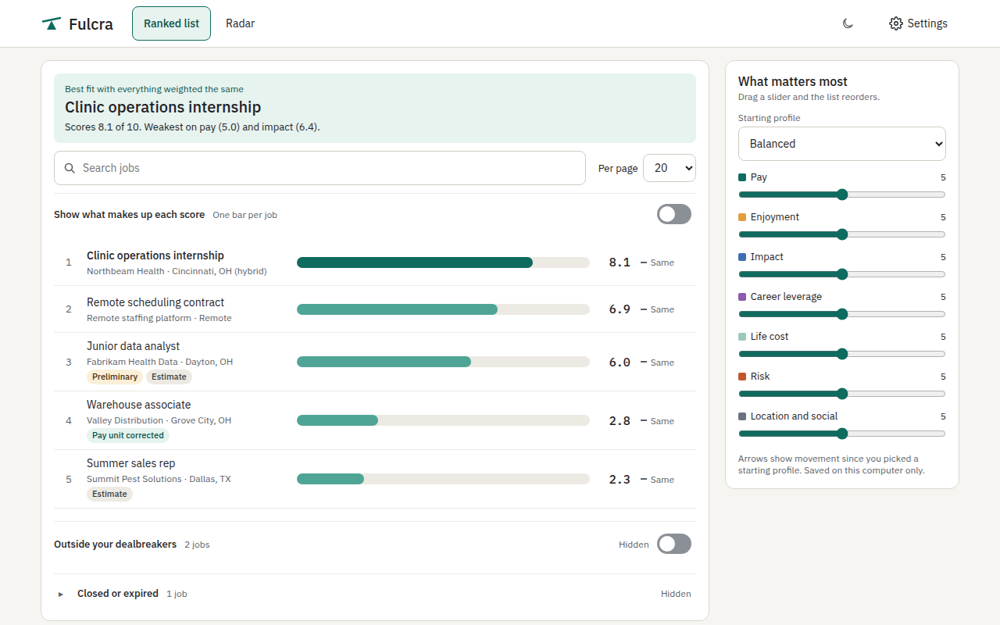

# Fulcra

It's a free browser extension that scores job offers on what matters to you, not just pay. It reads the postings you open and your job alert emails, then ranks and charts every job by your priorities.



Fulcra scores each job on seven things: pay, enjoyment, impact, career leverage, life cost, risk, and location and social cost. You set how much each one matters, and the list reorders as you move the sliders. Everything is stored on your computer. There are no accounts, no servers, and no analytics.

## Install

**From the Chrome Web Store:** coming soon. Install with one click, and setup opens in a new tab.

**From source:**

```sh
npm ci
npm run build
```

Then open `chrome://extensions`, turn on **Developer mode**, select **Load unpacked**, and choose `.output/chrome-mv3/`.

Each GitHub release also has a zip you can unpack and load the same way.

## Your OpenAI key

Fulcra uses OpenAI to read and score jobs, with your own API key. OpenAI bills you directly, and Fulcra never sees your payment details.

1. Go to [platform.openai.com](https://platform.openai.com) and sign in or create an account.
2. Add a payment method under Billing. A ChatGPT subscription doesn't include this.
3. Open **API keys** and select **Create new secret key**.
4. Paste it into Fulcra's setup and select **Continue**. Fulcra tests the key first and tells you if it doesn't work.

**Cost:** scoring costs about $1.20 per 1,000 jobs on the Standard model (about $4.50 on Sharper). Most people spend under $1 a month. Before any large batch (an email import, re-scoring after you change what you score, or Re-score all), Fulcra shows the count and cost and lets you pick **Score now**, **Half price** (OpenAI's Batch API: half the cost, finished within 24 hours and usually much sooner), or **Later**.

**Set a spend limit** in your OpenAI account under Limits, so costs can never surprise you.

## Using Fulcra

- **Score a posting:** open a job posting, select the Fulcra icon, then **Score this job**. You can also press `Alt+Shift+F`, or right-click the page or a link and choose **Score this job with Fulcra**.
- **Paste a link or text:** in the popup, paste a job link, or the text of an offer with no posting, like a message from a friend.
- **Setup** has four steps: your OpenAI key, a little about you, your job alert inboxes (at least one is required), and a summary where **Change** opens a step and brings you back.
- **Job alert emails:** in setup or Settings > Job alert emails, add each inbox that gets job alerts: one or more Gmail accounts, Outlook, or both. Once a day (or as often as you choose), Fulcra opens each inbox in turn in a background tab, tucked into a collapsed tab group named Fulcra, reads LinkedIn and Handshake job alerts that arrived since the last check, and closes it. **Import past alerts** reads the last 7, 30, or 90 days, or everything, with an estimate of the jobs and cost for each. Your emails stay marked unread, and nothing else in your inbox is read. Jobs from alerts get a **Preliminary** score from the email; open the posting and Fulcra upgrades it to a full score. Promotions and other non-job emails are left out, and anything the AI decides isn't a job listing is folded into **Not job listings**.
- **Compare:** the **Ranked list** is home. Drag the sliders in **What matters most** to reorder it; **Edit** opens Settings > Priorities to add, remove, or rename what Fulcra scores. Filters above the list (job type, remote or hybrid, no relocating, languages, lowest pay, most hours) apply to the ranked list and the radar alike. The **Radar** compares any number of jobs; click a name to open the job, or hover to highlight it.
- **Disagree with a score?** Open the job and select the pencil next to the score to type your own. If you keep correcting the same thing, Fulcra offers to change that weight.
- **Closed postings:** when a posting you open says it's no longer accepting applications, Fulcra moves it to **Closed or expired** at the bottom of the list.
- **Light or dark:** the sun/moon button in the header, or Settings > Appearance (it follows your system by default).

## How scores work

The model scores every dimension except pay from 1 to 10 (10 is always best for you), with a one-line reason. Fulcra works out pay and the overall score itself.

**Pay.** From the posting's pay range, Fulcra takes the midpoint and converts it to weekly pay (hourly pay × hours per week, defaulting to 40; monthly × 12 ÷ 52; yearly ÷ 52; a whole-job amount ÷ the job's weeks). Take-home over your time window of W weeks is

> T = weekly pay × min(job weeks, W) − known costs

and the pay score is

> pay score = 1 + 9 × min(1, max(0, T ÷ G))

where G is your pay goal, or the best take-home among your open jobs if you didn't set one. If you pick **No set time frame**, there's no T: jobs are compared by pay rate (per hour or per year, your choice), however long they last. Your pay goal and the lowest pay you'd take can be per hour, per year, or a total over your time frame; changing the unit converts them at 40 hours a week. Taxes aren't modeled; everything is "before tax." When a posting has no pay, the model estimates it and Fulcra labels it **Estimate**. When a number can't be right for its unit (like $16 a year or $110,000 an hour), Fulcra fixes it: it reads "$110K" as $110,000, trusts a unit written next to the amount, or picks the only unit the amount fits. When more than one unit could fit, it asks the model. Either way the job shows **Pay unit corrected** with an Undo.

**Spread across your jobs.** By default (Settings > Scoring), each dimension's AI scores are stretched across your open jobs so the best one on it shows 10 and the weakest shows 1, which makes small differences easy to see. It needs at least three scored jobs and at least a point of difference; your own scores are never stretched. Turn it off to see the raw scores.

**Overall score.** With your weights w (0 to 10) and the scores s:

> overall = Σ (w × s) ÷ Σ w

over the dimensions that have a score. If every weight is 0, they count equally.

**Filters** (once called dealbreakers) are checked against facts from the posting, never the model's opinion. A job that misses a must-have goes to **Filtered out** at the bottom, not deleted; if Fulcra can't tell, the job stays in. **Job type** hides other types instead.

## Privacy

- **What's sent to OpenAI:** the job text you score, plus your answers from About you and your dimension definitions. Nothing else, ever. Half-price batches upload the same text as a file to your OpenAI account; Fulcra deletes it when the results come back.
- **What stays on your computer:** everything else, in the extension's own storage.
- **Your key** is stored in Chrome's extension storage on this computer only. It never syncs to your Google account and is only ever sent to `api.openai.com`. **It is not encrypted at rest**: anyone with access to your computer's browser profile could read it. That's why a spend limit matters.
- **No analytics** and no servers. Fulcra doesn't phone home.
- **Reset Fulcra:** Settings > Your data > **Reset Fulcra** puts Fulcra back to a fresh install: it cancels any half-price batch still running, deletes all jobs, settings, inboxes, and your key, and starts setup again. Your key still exists in your OpenAI account; delete it there under API keys.

See [PRIVACY.md](PRIVACY.md) for details.

## Supported browsers and sites

- **Browsers:** Chrome is tested and supported. Edge and Firefox builds (`npm run build:firefox`) may work but aren't supported.
- **Job sites with built-in readers:** LinkedIn, Handshake, and Indeed. Any other job page works through the generic reader when you select the icon.
- **Email:** Gmail and Outlook on the web.

## Known limitations

- Requires a paid OpenAI API account. There is no free scoring option.
- Scores are a model's judgment from the posting text and can be wrong. Reasons are shown so you can judge, and you can always use your own score.
- Pay ignores taxes, benefits, and equity unless the posting states a total. Estimated pay is labeled.
- Email checks need Chrome to be open and you signed in to Gmail or Outlook in the same browser profile. Outlook reading is untested so far.
- Email reading depends on Gmail's and Outlook's page layouts, which can change without notice and break checks until Fulcra is updated.
- Jobs from alert emails get only a preliminary score until you open the posting. Fulcra can't always tell from an email that a job has closed.
- LinkedIn, Handshake, and Indeed layouts can change and break page reading. Pasting text always works.
- During email checks, a collapsed "Fulcra" tab group briefly appears in your tab strip. If you close it, that check stops and says so; the next one tries again.
- The API key is stored unencrypted in the browser's extension storage.
- Only Chrome is tested. English only.
- No after-the-job ratings, no import, no sync between computers, no mobile app.
- The name "Fulcra" is also used by Fulcra Dynamics' AI context product.

## Reporting problems

Open Settings > Help and diagnostics, select **Copy diagnostics**, and paste it into a [new issue](https://github.com/jinst255/fulcra/issues). Diagnostics include versions, counts, and recent error codes, never your key, job text, or emails.

## Contributing

```sh
npm ci            # install (runs wxt prepare)
npm run dev       # dev build with hot reload in .output/chrome-mv3-dev; load it unpacked once
npm test          # unit tests (vitest)
npm run typecheck
npm run lint
npm run build     # production build in .output/chrome-mv3
npm run zip       # store-ready zip
```

`npm run test:live` runs a small smoke test against the real OpenAI API (well under a cent). It's skipped unless `FULCRA_KEY_FILE` points to a file holding a key; keep that file outside the repo.

**Where things live:**

- `src/core/`: pay math, overall score, dealbreakers, dedupe, ranking, re-scoring, learning. Pure and tested.
- `src/llm/`: the OpenAI client, prompts, schemas, model IDs and prices (`models.ts`).
- `src/readers/`: page readers and email readers. **Site selectors live in one file per site** (`linkedin.ts`, `handshake.ts`, `indeed.ts`, `gmail.ts`, `outlook.ts`), each with a version constant. When a site changes its layout, update that file's selector lists, bump its version, and add a fixture under `tests/fixtures/`.
- `src/ui/`: React screens shared by the popup and the full-page app.
- `public/_locales/en/messages.json`: every UI string. The product name appears only in `appName`.
- `docs/blueprint.md`: the full design.

All dependencies are MIT, Apache-2.0, ISC, or BSD licensed. Please don't add a GPL dependency, a chart library, analytics, or anything that loads remote code.

## License

MIT. See [LICENSE](LICENSE).

Fulcra is not affiliated with LinkedIn, Handshake, Indeed, Google, Microsoft, or OpenAI.
